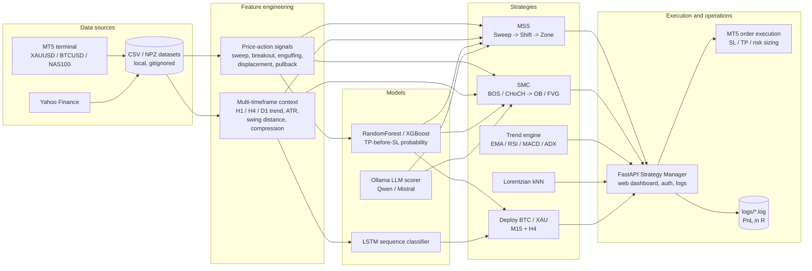
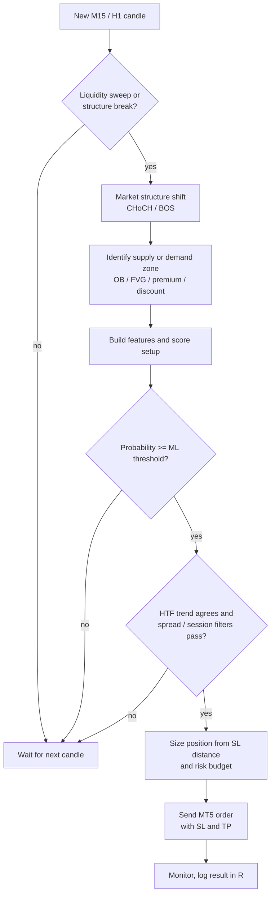
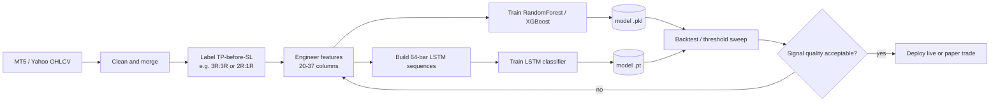
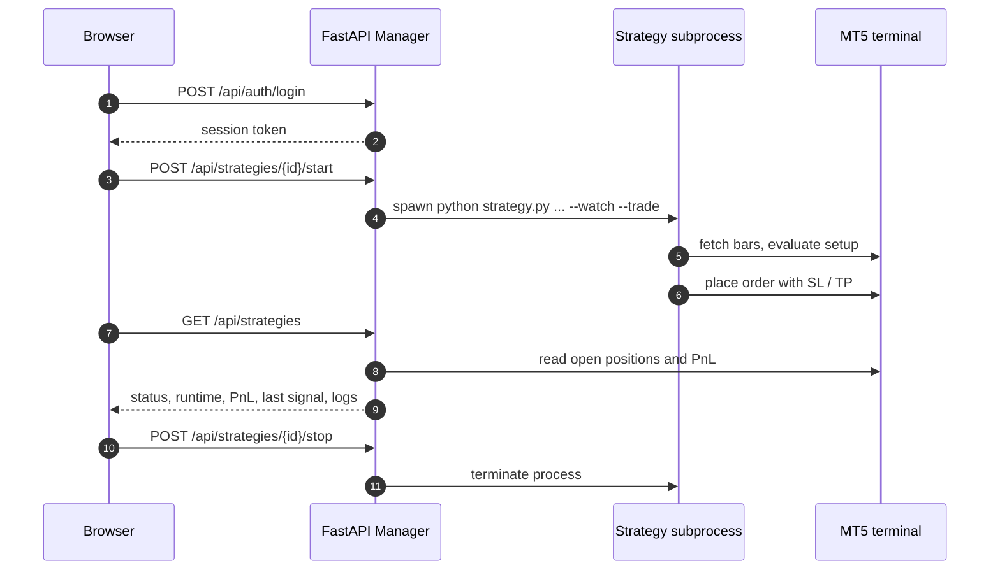

# AgenticAI Forex Trading System

A research-grade, MetaTrader 5 driven trading stack for **XAUUSD, BTCUSD and NAS100**. It combines
price-action / smart-money-concepts strategies, multi-timeframe context, machine-learning signal
filters (RandomForest, XGBoost, LSTM) and a small web dashboard that can start, stop and monitor
strategy processes.

> **Risk warning:** this is experimental research software, not a finished product. Backtest results
> do not guarantee future performance. Use a demo account first, keep position sizes small, and
> never run it with money you cannot afford to lose. The included notes document periods where the
> baseline signals performed worse than random — read them before trading.

---

## Overview

The project is organised as a chain of independent stages:

1. **Acquire** OHLCV data from the MT5 terminal and/or Yahoo Finance.
2. **Generate candidates** from price action: liquidity sweeps, breakouts, engulfing candles,
   displacement and trend pullbacks.
3. **Add context** from higher timeframes (H1, H4, D1) without future leakage.
4. **Score** each candidate with a trained model (TP-before-SL probability, LSTM sequence score, or
   an LLM confidence score).
5. **Filter and size** the trade using an ML threshold, ATR-based SL/TP and a risk budget.
6. **Execute** through MT5 in `--watch --trade` mode, either directly or from the manager dashboard.
7. **Measure** results in R multiples and iterate with backtests and threshold sweeps.

## Architecture



## Signal lifecycle

Most strategies follow the same candidate -> filter -> execution pattern:



## ML and data pipeline



## Strategy Manager control loop



---

## Repository layout

| Path | Purpose |
|------|---------|
| `manager/` | FastAPI + Bootstrap dashboard: auth, start/stop/restart, templates, logs, PnL, MT5 positions. |
| `sweep_mss_zone*.py` | MSS strategy family (v1-v5): liquidity sweep, structure shift, zone entry, ML filter. |
| `smc_strategy.py` | Smart Money Concepts: CHoCH/BOS, order blocks, fair value gaps, premium/discount, EQH/EQL. |
| `trend.py` | Multi-timeframe trend engine used by the dashboard and strategies. |
| `lorentzian_strategy.py` | Lorentzian-distance kNN classifier strategy. |
| `deploy.py` | XAUUSD M15 signal generator (ML + LSTM, 3R/3R structure). |
| `deploy_btc.py`, `deploy_xau.py` | M15+H4 ML deployment scripts with 3R:3R or 2R:1R profiles and binary/ternary modes. |
| `price_action_mtf_dataset.py` | Builds sequence datasets with price-action signals and HTF context. |
| `ml_pipeline.py`, `train_*.py` | Feature generation, labelling, model training (RF, XGBoost, LSTM, ternary). |
| `backtest_*.py`, `threshold_sweep*.py`, `compare_*.py` | Research and evaluation scripts. |
| `extract_historical_data*.py`, `download_*.py`, `merge_data_sources.py`, `fetch_*.py` | Data acquisition and merging. |
| `ai_analyses.py` | Local LLM scorer using Ollama (`qwen2.5:14b`, `mistral`). |
| `*.txt` | Strategy specifications and Pine Script references. |
| `mss_visuals/` | Diagrams of the MSS pipeline. |
| `rf_tree_strategy.pine` | TradingView reference implementation. |
| `requirements-neural.txt` | Minimal NumPy / Pandas / PyTorch dependency set. |

### Strategies at a glance

| Strategy | Core idea | Model / filter | Main files |
|----------|-----------|----------------|------------|
| **MSS** | Sweep a swing high/low, wait for a market structure shift, enter from the resulting zone. | RandomForest or XGBoost probability, ML threshold, ATR SL/TP. | `sweep_mss_zone*.py` |
| **SMC** | CHoCH/BOS followed by OB/FVG retracement; EQH/EQL for premium/discount reversals. | RandomForest probability + HTF bias. | `smc_strategy.py` |
| **Trend** | Weighted EMA/RSI/MACD/ADX and structure scoring across H4/H1/M15 (optionally D1). | Rule-based scoring. | `trend.py` |
| **Lorentzian** | Approximate nearest neighbours with Lorentzian distance on technical features. | kNN classifier. | `lorentzian_strategy.py` |
| **BTC/XAU deploy** | M15 entry model confirmed by H4 context; optional retracement entry. | Binary or ternary ML model, 3R:3R / 2R:1R. | `deploy_btc.py`, `deploy_xau.py` |

---

## Getting started

### Prerequisites

- Windows (the `MetaTrader5` Python package is Windows-only).
- Python 3.10+.
- A running MT5 terminal, logged into the broker account you intend to use.
- Optional: [Ollama](https://ollama.com/) with `qwen2.5:14b` or `mistral` for the LLM scorer.

### 1. Install dependencies

```powershell
python -m venv .venv
.\.venv\Scripts\Activate.ps1

pip install numpy pandas scikit-learn xgboost torch ta matplotlib yfinance `
    MetaTrader5 fastapi "uvicorn[standard]" joblib pytz openai ollama
```

`requirements-neural.txt` covers only the NumPy/Pandas/PyTorch subset. The manager's own
dependencies are in `manager/requirements.txt`.

### 2. Configure credentials

All account credentials are read from environment variables. Copy `.env.example` for reference and
set the values in your shell before running anything that connects to MT5:

```powershell
$env:MT5_ACCOUNT   = "12345678"
$env:MT5_PASSWORD  = "your-password"
$env:OPENAI_API_KEY = "sk-..."   # only needed by test_openai.py
```

The broker **server name** is currently hardcoded in the strategy scripts
(for example `Pepperstone-Demo` and `PepperstoneBS-MT5-Live01`). Edit it to match your broker.

### 3. Run the manager dashboard

```powershell
python manager\main.py
```

Open <http://localhost:5000>. If `manager/cert.pem` and `manager/key.pem` exist, the server starts
with HTTPS instead. The default password is `password123` and is stored in `manager/.secret`;
change it before exposing the dashboard on a network.

### 4. Run a strategy directly

```powershell
# Backtest
python sweep_mss_zone.py XAUUSD --backtest --tf m15
python smc_strategy.py XAUUSD --backtest --tf h1

# Live monitoring / auto-trading (demo account strongly recommended)
python sweep_mss_zone.py XAUUSD --watch --trade --tf m15 --ml-threshold 0.7
python smc_strategy.py XAUUSD --watch --trade --tf h1 --ml-threshold 0.7

# Deployment models
python deploy_xau.py --backtest --risk-profile 2r1r
python deploy_xau.py --watch --trade --risk-profile 2r1r --approach ternary
```

### 5. Train a model

```powershell
# LSTM on price-action + multi-timeframe sequences
python price_action_mtf_dataset.py XAUUSD_M15_combined.csv --output dataset.npz --meta-output meta.csv
python train_lstm_price_action.py dataset.npz --model-output lstm_price_action.pt --epochs 50

# MSS ML filter (RandomForest / XGBoost depending on the script version)
python sweep_mss_zone.py XAUUSD --train-ml
```

### 6. Acquire data

```powershell
# Yahoo Finance history (symbol, start, end, interval are positional arguments)
python download_yahoo_xauusd.py 2015-01-01 2025-12-31 15m

# Broker history (symbol, timeframe, optional output file)
python extract_historical_data_v2.py XAUUSD M15

# Merge the two sources
python merge_data_sources.py XAUUSD_M15.csv XAUUSD_M15_yahoo.csv XAUUSD_M15_combined.csv
```

---

## Data and model artifacts

CSV, NPZ, PKL, PyTorch and parquet artifacts are **not committed** (see `.gitignore`) because they
are large and regenerable. The repository ships source code only, so to run a strategy you must
either:

- download/build the CSVs into the repository root, and
- train the models, or copy the `.pkl` / `.pt` files into the repository root.

The manager and deployment scripts look for models by filename in the current working directory
(for example `sweep_ml_XAUUSD_m15.pkl`, `ml_xau_m15h4_v2.pkl`, `lstm_price_action.pt`).

The local `tradingview-mcp/` folder is a third-party working copy and is intentionally ignored.

## Documentation index

| Document | Content |
|----------|---------|
| `STRATEGY_REVISION.md` | Strategy design: price action candidates, MTF context, LSTM scoring, execution filters. |
| `COMPLETE_WORKFLOW.md` | End-to-end data -> dataset -> signal quality -> LSTM training workflow. |
| `REVIEW_INDEX.md` | Summary of reviews, findings and recommended next steps. |
| `ACTION_CHECKLIST.md` | Step-by-step checklist for data, signal fixes and training. |
| `LSTM_TEST_ANALYSIS.md` | Root-cause analysis of weak LSTM metrics and suggested fixes. |
| `SIGNAL_FILTER_TEST_RESULTS.md` | Results of signal-filter experiments. |
| `SIGNAL_REDESIGN_ACTION_PLAN.md` | Plan for redesigning the signal layer. |
| `BROKER_DATA_LIMITATION_SOLUTIONS.md` | Broker history limits and data-source options. |
| `EXTRACT_DATA_ANALYSIS.md`, `EXTRACT_DATA_QUICK_FIX.md` | Data extraction diagnostics and fixes. |

## Security

- Never commit `.secret`, `.pem`, `.key`, `.env` or real account credentials.
- Credentials are loaded from environment variables; `.env.example` is a template only.
- If credentials were ever stored in plaintext or pushed to a remote, rotate them.

## License

Released under the [MIT License](LICENSE).

## Disclaimer

This software is provided for education and research. It is not financial advice, comes with no
warranty, and may place real orders. You are responsible for every trade it executes. Test on a demo
account and review the strategy notes before enabling `--trade`.
